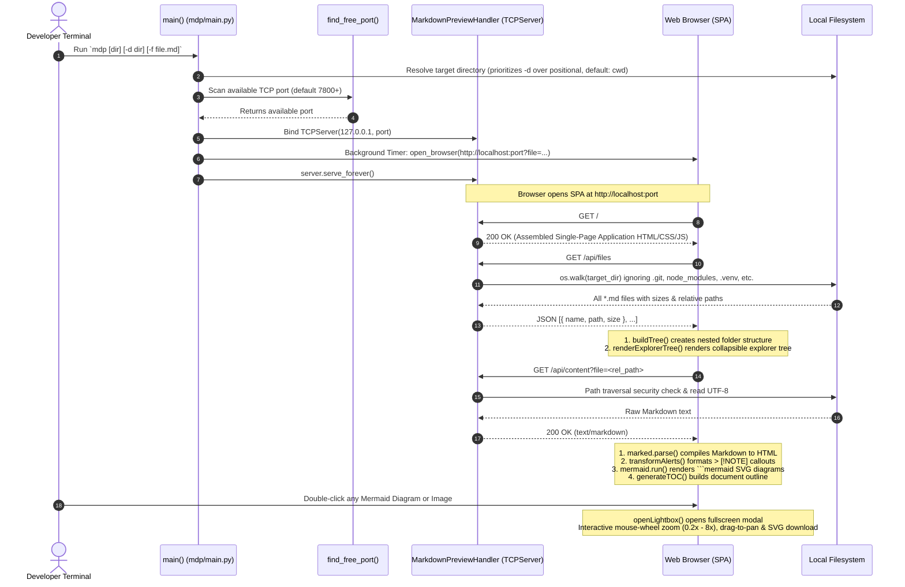

# `mdp` — Markdown Preview Pane Tool Manual & Architecture

---

| Metadata        | Value                                                              |
| --------------- | ------------------------------------------------------------------ |
| Command         | `mdp` (`mdp.exe` or `D:\sw\batch\mdp.cmd`)                         |
| Script Engine   | Modular package in `D:\_codes\man\mdp\` (`main.py`)                |
| Documentation   | `D:\_codes\man\docs\mdp.md` (`man mdp`)                            |
| Dependencies    | Python 3 Standard Library only (Zero `pip install` required)       |
| Default Port    | `7800` (auto-increments if port is in use)                         |
| Target Audience | Developers, Technical Writers, QA, System Architects               |
| Architecture    | Modular: `template`, `server`, `browser`, `process`, `main`, `web` |
| Last Updated    | 2026-10-01                                                         |

---

## 1. Overview

**`mdp`** (Markdown Previewer) is a standalone, zero-dependency Python utility that turns any terminal into an IDE-grade **Two-Pane Markdown Browser**:

- **Left Pane (Hierarchical Explorer)**: Real nested folder tree with collapsible folders, chevrons, file-count badges, and real-time search.
- **Right Pane (Markdown Viewer)**: Rich GitHub-rendered document reader with syntax-highlighted code blocks, tables, GitHub callouts (`[!NOTE]`, `[!TIP]`, etc.), document zoom controls, and native Mermaid diagram rendering with full-screen zoom and pan inspection.

Because `mdp` is packaged with `man` in `D:\_codes\man` and wrapped by `D:\sw\batch\mdp.cmd` (on system `PATH`), it can be executed from **any directory on your computer**. When invoked with no arguments, it automatically scans the directory from which it was called.

---

## 2. Command Line Usage

### Basic Commands

```cmd
:: 1. Preview all Markdown files in the current folder (where executed)
mdp

:: 2. Preview a specific directory (via positional argument or -d flag)
mdp _docs
mdp -d "D:\_Projects\lc"
mdp --start-dir "D:\_codes\man"

:: 3. Open a specific file directly on startup
mdp -f README.md
mdp -d "D:\_Projects\lc" -f CONFIG-GUIDE.md

:: 4. Expand all folders by default in explorer tree
mdp -e
mdp -d "D:\_Projects\lc" -e

:: 5. Specify which browser to open (chrome, edge, firefox, brave, default)
mdp -b chrome
mdp -b edge
mdp -b firefox

:: 6. Custom port
mdp -p 8080
mdp -d _docs -p 9000

:: 7. Check status of running mdp instances
mdp -s
mdp --status

:: 8. Stop / kill running mdp instances
mdp -k
mdp --kill
mdp -k -p 7800

:: 9. Register mdp manual into man (Universal Manual Reader)
mdp -ah
mdp --add-help
```

### CLI Parameters Reference

| Parameter | Alias | Default | Description |
|---|---|---|---|
| `directory` | Positional | `None` | Directory to scan for `.md` files (default: current working directory). |
| `--dir`, `--directory`, `--start-dir` | `-d` | `None` | Explicit start directory to scan for `.md` files (overrides positional). |
| `--file` | `-f` | `""` | Initial markdown file (relative path or filename) to open/preview on startup. |
| `--expand` | `-e` | `false` | Expand all folders in the explorer tree by default (default: collapsed). |
| `--add-help` | `-ah` | `None` (or `"mdp"`) | Automatically registers `mdp` manual (or custom topic) into `man` catalog (`man -a`). |
| `--status` | `-s` | Flag | Check status, PID, port, uptime, and scanned path of active `mdp` instances. |
| `--kill` | `-k` | Flag | Terminate running `mdp` instance(s). Combine with `-p <port>` to kill a specific port. |
| `--port` | `-p` | `7800` (auto-detects) | TCP port for the local HTTP server. |
| `--browser` | `-b` | `default` | Specify browser executable: `default`, `chrome`, `edge`, `firefox`, `brave`. |
| `--no-browser` | Flag | `false` | Disables automatic opening of the browser. |
| `--keep-alive` | Flag | `false` | Keeps the server running indefinitely even after the browser tab is closed. |

> [!TIP]
> **Automatic Process Termination**: By default, `mdp` automatically shuts down its local server and returns your terminal to the prompt as soon as you close the browser tab or window. A background heartbeat pings every 2.5s; when the tab unloads (`pagehide` / `beforeunload`), it notifies the server to gracefully terminate.

---

## 3. Key Capabilities

### 1. Hierarchical Folder Explorer
- **Real Nested Tree**: Reflects the actual folder structure on disk.
- **Collapsible Folders**: Click any folder to expand/collapse (`📂`/`📁`), with smooth rotating chevrons (`▾`/`▸`).
- **File Count Badges**: Shows how many markdown documents reside inside each folder.
- **Expand / Collapse All**: Quick action links in the sidebar header to toggle all folders simultaneously.
- **Live Search (`Ctrl+K`)**: Filters files in real time. Matching results automatically expand all ancestor folders.

### 2. Native Mermaid Diagram Rendering & Lightbox Inspector
- Intercepts and compiles `mermaid` code blocks into clean SVG vector diagrams.
- Supports Flowcharts, Sequence Diagrams, Class Diagrams, State Diagrams, ER Diagrams, and XY Charts.
- Synchronizes with Dark/Light theme switching.
- **Double-Click or Click `⛶ Enlarge`**: Opens the diagram in full-screen Lightbox Modal.
- **Interactive Controls**: Mouse wheel zoom (`0.2x` to `8.0x`), click-and-drag pan, 1:1 crisp font view, and `⬇ Save SVG` download button.

### 3. Document Zoom Controls
- Adjust reader font size with `A+` / `A-` buttons in toolbar or keyboard shortcuts:
  - `Ctrl` + `+` / `Ctrl` + `=` : Zoom In (+10%)
  - `Ctrl` + `-` : Zoom Out (-10%)
  - `Ctrl` + `0` : Reset Zoom (100%)
- Setting persists in `localStorage`.

### 4. GitHub Alert Callouts
Automatically transforms GitHub-style blockquote alerts into formatted callout boxes:
- `> [!NOTE]` (Blue info box)
- `> [!TIP]` (Green success box)
- `> [!IMPORTANT]` (Purple alert box)
- `> [!WARNING]` (Amber warning box)
- `> [!CAUTION]` (Red danger box)

### 5. Document Outline (TOC) & Theme Switching
- Click **`📑 Outline`** in the header to open a floating quick-jump table of contents.
- **Theme Toggle**: Switch between Light and Dark mode with persistence in `localStorage`.
- **Copy Raw Markdown**: One-click `📋 Copy` button to copy the active markdown content.

---

## 4. Architecture & End-to-End Code Flow

The following Mermaid sequence diagram illustrates the lifecycle of `mdp` from terminal execution to in-browser rendering:



---

## 5. Repository Structure in `D:\_codes\man\`

```
D:\_codes\man\
├── man/                  ← Universal Manual Reader (terminal engine)
│   ├── __init__.py
│   ├── cli.py            ← Launches terminal reader or delegates to mdp (-b)
│   ├── config.py         ← Central configuration manager (man_config.json)
│   └── reader.py         ← Rich terminal Markdown renderer with pager
├── mdp/                  ← Markdown Preview Pane (browser SPA engine)
│   ├── __init__.py       ← Package root (__version__ = "2.1.0")
│   ├── main.py           ← CLI argument parsing & orchestration
│   ├── process.py        ← Port scanner, status check & process killer
│   ├── browser.py        ← Multi-browser launcher (Chrome, Edge, Firefox, Brave)
│   ├── server.py         ← HTTP server (MarkdownPreviewHandler) & watchdog
│   ├── template.py       ← Modular CSS/JS bundle loader
│   └── web/              ← Single-Page Application assets
│       ├── index.html
│       ├── css/          (theme, layout, markdown, mermaid, lightbox)
│       └── js/           (ui, explorer, markdown, viewer, lightbox, heartbeat)
├── docs/                 ← Official manual documentation
│   ├── man-usage.md      ← Manual for `man`
│   └── mdp.md            ← Manual for `mdp` (this document)
├── pyproject.toml        ← Unified package configuration (`man` and `mdp` console scripts)
└── man_config.json       ← Topic lookup catalog (supports `man mdp`)
```

---

## 6. Accessing via `man`

Because `mdp.md` is registered in `D:\_codes\man\man_config.json`, you can view this manual anytime from anywhere:

```bash
# Read in terminal:
man mdp

# Open in browser via mdp itself:
man mdp -b
```
